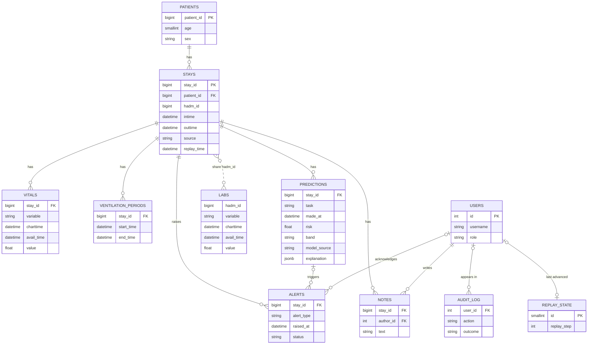

# Database (Phase 7, Part B)

PostgreSQL stores everything the dashboard shows: the patients and their ICU stays, every vital sign and lab result, every stored risk prediction with its explanation, the alerts, the notes, the users and an audit log.
The tables are defined in Python (`backend/app/db/models.py`) and created by an Alembic migration (`backend/migrations/versions/0001_create_tables.py`).
This file is written so you can explain the design in an interview.

Part B creates the **empty** tables only. Part C fills them with the demo data. Part D adds login.

---

## 1. The tables

The same diagram as a picture for your report: `docs/database_diagram.png`.

| Table | One row is | Why it exists |
|---|---|---|
| `users` | a person who can log in | Password stored only as a hash, plus a role (`clinician` or `admin`). Used from Part D. |
| `patients` | a patient | Age and sex. MIMIC ids are kept; patients added in the app get ids from 90,000,001 so they never collide. |
| `stays` | one ICU stay | The main object of the app: risk, replay clock and alerts all belong to a stay. Holds `intime`, `outtime`, `source` (`dataset_replay` or `live_entry`), `died_in_icu` and the replay clock (`replay_start_time`, `replay_time`). |
| `vitals` | one vital-sign value | Heart rate, breathing rate, SpO2, blood pressure, temperature, GCS, plus `o2_device` (any oxygen device charted). |
| `labs` | one lab result | Belongs to the hospital admission (`hadm_id`), as in MIMIC. A stay finds its labs through its `hadm_id`. |
| `ventilation_periods` | one episode on a ventilator | The model input "on a ventilator now" is worked out from these. `end_time` is empty while a live patient is still ventilated. |
| `predictions` | one stored risk prediction | Risk, band, NEWS2/MEWS, where it came from (`cross_validated` or `live_model`), and the whole explanation as JSON. |
| `alerts` | one early-warning alert | Which stay, when, what the risk was, and who acknowledged it and when. |
| `notes` | one clinician note | Text up to 2,000 characters, author, and the hour of the stay when it was written. |
| `audit_log` | one action | Who did what and when (logins, views, notes, replay changes). Failed logins are kept too. |
| `replay_state` | the single global clock | Current replay step and who last advanced it. A rule forces `id = 1`, so there can only be one row. |

---

## 2. Design choices and the reasons (interview answers)

**Why does every measurement have two times, `charttime` and `avail_time`?**
`charttime` is when the value was measured. `avail_time` is when a clinician could first see it (when it was stored). The model's features and the dashboard replay both use `avail_time`, so the dashboard never shows a value before it was really available. This is the same no-leakage rule used in Phase 4.

**Why store predictions instead of computing them when a page opens?**
For the 100 dataset patients the honest predictions are the cross-validated ones: each comes from a model that never saw that patient. The saved final model was fitted on all 100 patients, so using it on them would show overconfident risks. Storing the cross-validated predictions once makes the dashboard fast and honest. New patients added through the app are predicted live and marked `live_model`.

**Why store the explanation as JSON inside the prediction row?**
An explanation (top factors, groups, narrative, warnings) is always read together with its prediction and never searched on its own. One JSONB column is simpler than five extra tables, and PostgreSQL can still query inside it. About 2,100 predictions with a few KB each is only 10 to 20 MB.

**Why are labs attached to the hospital admission and not to the stay?**
MIMIC records labs per hospital admission, and the Phase 4 features use them that way (including results taken before ICU admission). The database follows the same rule so the features rebuilt from it match the ones the models were trained on.

**Why do patient time and real time use different column types?**
MIMIC dates are shifted decades into the past, so they only order events (`DateTime` without a zone). Notes, logins and acknowledgements happen in real life, so they use `DateTime` with a zone and default to the database's current time.

**Why 90,000,001 for new ids?**
MIMIC ids are below 90,000,000. Three PostgreSQL sequences (`patient_id_seq`, `stay_id_seq`, `hadm_id_seq`) start at 90,000,001, so a patient added in the app can never clash with a dataset patient.

**Why so many CHECK constraints?**
The database itself refuses nonsense: a readmission prediction with a Low/Moderate/High band, an acknowledged alert with nobody who acknowledged it, a stay that ends before it starts, a dataset stay without replay times, an unknown role. The API checks the same things, but the database is the last line of defence, and the tests prove each rule works.

**Why Alembic and not "create all tables in code"?**
A migration is a versioned, repeatable change. `alembic upgrade head` builds the same database on any machine, and a later change (for example a new column in Part E) is a new migration instead of deleting and recreating the data. `alembic downgrade base` undoes it.

**What if two users acknowledge the same alert?**
The second one gets a `409 conflict` from the API (Part F). The alert table keeps who acknowledged it first.

---

## 3. Set up on your laptop (Windows first)

You need PostgreSQL running and your `postgres` password. Run everything from the project root with your virtual environment active.

1. **Install the packages** (nothing new is needed if you installed `requirements.txt` earlier):
   `pip install -r requirements.txt`
2. **Create the empty database** (once):
   - Command line: `createdb -U postgres -h localhost icu_risk` (it asks for your password), or
   - pgAdmin: right-click Databases, Create, Database, name it `icu_risk`.
3. **Create your private settings file**:
   `copy .env.example .env`
   then open `.env` and replace `change-me` with your PostgreSQL password. If your `.env` already has a `DATABASE_URL=` line from Phase 0, delete that line (it overrides the others).
4. **Check the connection**: `python -m backend.app.db.check`. It should say `Connected` and `Tables: 0 of 11 found`.
5. **Create the tables**: `alembic upgrade head`.
6. **Check again**: `python -m backend.app.db.check`. It should list 11 tables with 0 rows and finish with `All good.`
7. **Optional checks**: `alembic check` should say `No new upgrade operations detected.` (the models and the database agree).

To start over with empty tables: `alembic downgrade base` then `alembic upgrade head`.

### Viewing the tables in pgAdmin
Servers, PostgreSQL, Databases, `icu_risk`, Schemas, public, Tables. Right-click a table, View/Edit Data, All Rows. Once Part C has run, this is where you can look at the demo patients and predictions.

### Docker instead (optional)
`docker compose up -d` starts a PostgreSQL 16 on port **5433** using DB_NAME, DB_USER and DB_PASSWORD from your `.env`. Set `DB_PORT=5433` in `.env`, then follow steps 4 to 6 above (the database already exists, so skip step 2). `docker compose down` stops it; your data stays in a volume.

---

## 4. If something goes wrong

| Message | Meaning and fix |
|---|---|
| `DB_PASSWORD is empty` | There is no `.env`, or `change-me` was not replaced. Do step 3. |
| `password authentication failed` | Wrong `DB_USER` or `DB_PASSWORD` in `.env`. |
| `database "icu_risk" does not exist` | Do step 2. |
| `Connection refused` | PostgreSQL is not running (Windows: Services, postgresql-x64-xx, Start) or `DB_PORT` is wrong (5432 native, 5433 Docker). |
| `UnicodeDecodeError` while connecting (Windows) | The driver cannot read PostgreSQL's error text in a non-English Windows language. It almost always means a wrong password or database name. The check script says this in plain words. |
| `Can't locate revision` or `Target database is not up to date` | The `alembic_version` table does not match the files. Tell me the exact message; do not delete tables by hand. |
| Output shows `[taken from DATABASE_URL ...]` | A `DATABASE_URL` line in `.env` is overriding the five `DB_*` lines. Delete it or put the real password in it. |

---

## 5. What the tests cover

`tests/test_db_models.py` runs on a temporary in-memory SQLite database, so it needs no PostgreSQL and cannot touch your data. It checks that all 11 tables exist, that every rule above is enforced (18 rejected-row cases, each rejected by its CHECK constraint), duplicates, foreign keys, cascade deletes, default values, JSON storage, that the fixed vocabularies match the ML code, that the migration lists the same tables as the models, and that a password with special characters such as `@ : / #` survives in the connection address.
The migration itself was run on a real PostgreSQL 16 (upgrade, `alembic check`, downgrade, upgrade again), including id numbering from 90,000,001 and the JSON column.
